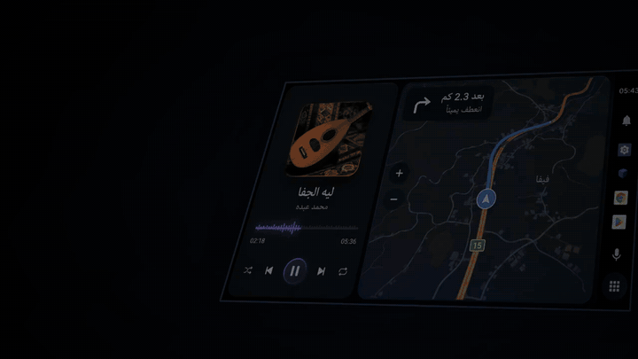

<div align="center">


**واجهة قيادة لأجهزة أندرويد المخصصة للسيارات.**

Android launcher for aftermarket head units.

[](https://developer.android.com/)
[](https://www.instagram.com/wu3x/)

<a href="https://github.com/wu3x/rouh-auto/releases/download/latest-signed/rouh-auto-release.apk"></a>

[**حالة البناء**](https://github.com/wu3x/rouh-auto/actions/workflows/build.yml) · [**الملفات**](app/src/main/java/org/wpfy/carlauncher)



</div>

## ROUH Auto

واجهة أندرويد أفقية صُممت للاستخدام داخل السيارة. تجمع التطبيقات والوسائط والخريطة والإشعارات في تجربة واحدة، مع دعم العربية واتجاه RTL.

A native Android launcher built with Kotlin and Jetpack Compose, designed for landscape car displays and Arabic-first interaction.

## Features

- **Home:** لوحة قيادة قابلة للتخصيص مع حالة الجهاز والاختصارات.
- **Media:** عرض جلسات الوسائط والتحكم بالتشغيل عند دعم التطبيق المصدر.
- **Apps:** البحث عن التطبيقات وتشغيلها وتثبيت المفضلة.
- **Maps:** تتبع الموقع، خريطة جازان دون اتصال عبر MBTiles، وخريطة عبر الإنترنت عند توفر الشبكة.
- **Notifications:** عرض الإشعارات بعد منح الإذن.
- **Settings:** تخصيص الواجهة وإعدادات التشغيل.

## Install

[**Download the signed APK**](https://github.com/wu3x/rouh-auto/releases/download/latest-signed/rouh-auto-release.apk) and install it on an Android **9+** device. Grant only the permissions needed for the features you use. Set ROUH Auto as the default home app if desired.

**Offline map:** Open the Saudi offline maps dialog and download Jazan. The map pack is stored on-device for use without a network connection. GPS availability depends on the hardware and system permissions; online fallback requires internet access.

## Build

Requires JDK 17 and the Android SDK.

```bash
./gradlew assembleDebug
```

Built with **Kotlin · Jetpack Compose · Material 3 · Coroutines · Gradle**.

## Compatibility

Designed for landscape aftermarket Android head units. Bluetooth audio routing, MCU features, and vehicle integrations depend on the device manufacturer. Vehicle diagnostics and CAN bus access require compatible hardware and are not guaranteed.

**Development status:** Active development. Validate on your target head unit before relying on device-specific features.

---

<div align="center"><sub>ROUH Auto · Android car launcher</sub></div>
